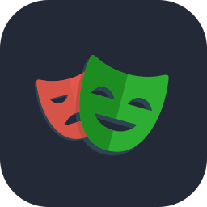
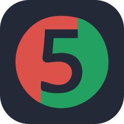
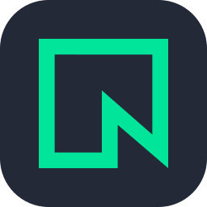

<p align="center">
  
</p>

<p align="center">
  
</p>

<p align="center">
  
  
  
  
  
  
  <a href="https://www.datacamp.com/certificate/AIEDA0010743944196"></a>
  
  
</p>

<p align="center">
  <a href="#featured-projects"></a>
  <a href="https://www.linkedin.com/in/alaa-aldeen-a-098801331/"></a>
  <a href="mailto:alhkmyla39@gmail.com"></a>
  <a href="https://github.com/alhkmyla39"></a>
</p>

<p align="center">
  <a href="https://github.com/alhkmyla39"></a>
  <a href="https://github.com/alhkmyla39?tab=followers"></a>
  <a href="https://github.com/alhkmyla39?tab=stars"></a>
</p>


## About

I’m Alaa Aldeen, a Software Engineering undergraduate at Taylor’s University in Malaysia. I’m based in Kuala Lumpur and expect to graduate in August 2027. My goal is to work as a Software Engineer.

I’m learning how to integrate language models into applications and how to design the APIs and databases those applications depend on. My university coursework covers software design, testing, operating systems, and data processing. My featured work also includes independent projects and practice repositories. My university internship is scheduled for 19 April–6 August 2027.

<div align="center">
<table>
<tr><th>Focus area</th><th>What I work on</th></tr>
<tr><td>Full-stack development</td><td>Web interfaces, APIs, and relational databases</td></tr>
<tr><td>Applied AI</td><td>Study tools grounded in uploaded notes, with cited answers</td></tr>
<tr><td>Data systems</td><td>Report imports, validation, and dashboards</td></tr>
<tr><td>Software design</td><td>Object-oriented design, design patterns, and testing</td></tr>
</table>
</div>


## Open To

<p align="center">
  <a href="mailto:alhkmyla39@gmail.com"></a>
  <a href="https://www.linkedin.com/in/alaa-aldeen-a-098801331/"></a>
  <a href="https://github.com/alhkmyla39"></a>
</p>


## Education

**Bachelor of Software Engineering (Honours)** · Taylor’s University, Selangor, Malaysia  
September 2024–August 2027 (expected)

- Object-oriented design and design patterns in Software Construction.
- Requirements, UML, and software architecture in Software Design & Modelling.
- Process creation, execution, and synchronization in Operating Systems.
- Relational data modelling, SQL, and database-backed applications.
- Batch data processing with Hadoop, Hive, and Spark SQL in Big Data coursework.

<p align="center">
  
  
  
  
  
</p>


## Tech Stack

| Category | Tools |
| --- | --- |
| Languages | <a href="https://dev.java/"></a> <a href="https://www.python.org/"></a> <a href="https://www.open-std.org/jtc1/sc22/wg14/"></a> <a href="https://developer.mozilla.org/en-US/docs/Web/JavaScript"></a> <a href="https://www.typescriptlang.org/"></a> |
| Frontend | <a href="https://html.spec.whatwg.org/"></a> <a href="https://www.w3.org/Style/CSS/"></a> <a href="https://react.dev/"></a> |
| Backend & databases | <a href="https://fastapi.tiangolo.com/"></a> <a href="https://nodejs.org/"></a> <a href="https://www.postgresql.org/"></a> <a href="https://www.mysql.com/"></a> <a href="https://sqlite.org/"></a> |
| Testing | <a href="https://playwright.dev/"></a> <a href="https://junit.org/"></a> |
| Cloud & deployment | <a href="https://supabase.com/"></a> <a href="https://render.com/"></a> <a href="https://neon.com/"></a> <a href="https://github.com/features/actions"></a> |
| Build, version control & design | <a href="https://git-scm.com/"></a> <a href="https://github.com/"></a> <a href="https://maven.apache.org/"></a> <a href="https://www.figma.com/"></a> <a href="https://www.kernel.org/"></a> <a href="https://code.visualstudio.com/"></a> |

I also use SQL for relational databases, JavaFX for desktop coursework, and Hadoop, Hive, and Spark SQL for data coursework.

<p align="center">
  
  
</p>


## Software Engineering Focus

<div align="center">
<table>
<tr><th>Domain</th><th>Level</th><th>Details</th></tr>
<tr><td>Object-oriented programming</td><td>Hands-on</td><td>Java classes, interfaces, and design patterns</td></tr>
<tr><td>Web interfaces</td><td>Hands-on</td><td>HTML, CSS, JavaScript, React, and TypeScript interfaces</td></tr>
<tr><td>Backend APIs</td><td>Hands-on</td><td>FastAPI endpoints and input validation</td></tr>
<tr><td>Relational databases</td><td>Hands-on</td><td>SQL, SQLite, and PostgreSQL</td></tr>
<tr><td>Testing</td><td>Hands-on</td><td>pytest and Playwright in projects, JUnit in coursework</td></tr>
<tr><td>Data engineering</td><td>Foundational</td><td>HDFS, Hive, Spark SQL, and MapReduce coursework</td></tr>
<tr><td>Applied AI</td><td>Hands-on</td><td>Language model answers with source citations in Thakerli</td></tr>
</table>
</div>


## Featured Projects

| Project | Description | Tech stack |
| --- | --- | --- |
| **[Thakerli · ذاكرلي](https://github.com/alhkmyla39/thakerli-explaintion#readme)**<br>Independent developer<br>[Live site](https://thakerli.tech/) | An Arabic and English AI study assistant that helps students learn from their own text and PDF notes. Students can ask questions, follow cited excerpts back to the original material, and generate quizzes and flashcards. I built the application’s study workflows, including saved practice, timed quizzes, mistake review, and learning progress tracking. | Python · FastAPI · HTML · CSS · JavaScript · SQLite · PostgreSQL · Groq · pytest · GitHub Actions |
| **[Maalivo · ماليفو](https://github.com/alhkmyla39/maalivo-explaintion#readme)**<br>Independent developer<br>In development | A bilingual retail analytics platform that turns spreadsheet and CSV reports into sales dashboards. The import workflow detects fields for review, validates records, checks duplicate transactions, and reconciles monthly summaries with detailed sales data before publication. I built the reporting workflows and tested analytics journeys with Playwright, with a focus on keeping KPI figures traceable to their source reports. | Python · FastAPI · React · TypeScript · SQLite · Playwright |
| **[StaleGuard](https://github.com/alhkmyla39/StaleGuard#readme)**<br>Frontend developer<br>Global AI Hackathon · Team project | An AI answer verification tool that identifies time-sensitive claims, checks them against web sources, and displays freshness scores with supporting evidence. Users can review claims and compare a corrected answer with the original. I owned the responsive React and TypeScript interface for claim review and results on desktop and mobile, as part of the hackathon team. | React · TypeScript · Vite · Python · FastAPI · SQLite · Bifrost · Groq · Tavily |
| **CollabWisely**<br>Information Retrieval & Evaluation<br>Taylor’s team capstone · In progress | An AI collaboration workspace being designed to connect team documents, chat, tasks, and agent proposals with owner approvals. I design document and chat ingestion, hybrid retrieval, and source citations. My evaluation plan includes a 50-question retrieval benchmark and a System Usability Scale study, coordinated with teammates responsible for the frontend, backend, orchestration, and governance. | Planned stack · Python · FastAPI · PostgreSQL · pgvector · LangGraph |

**Academic projects** · StudyMate, an accessibility-focused JavaFX team project, and hotel booking analytics using Hadoop, Hive, and Spark SQL.


## Experience

### Upcoming university internship

**19 April–6 August 2027** · Software engineering internship window

### Software Engineering Student · Taylor’s University

**Selangor, Malaysia** · September 2024–present

- Design and implement coursework in Java and Python.
- Apply UML, object-oriented design patterns, and unit testing in software construction assignments.
- Work with relational databases and batch data processing in academic projects.
- Build and refine web and AI applications through independent practice.

<p align="center">
  
  
  
</p>


## Achievements

<div align="center">
<table>
<tr><th>Recognition</th><th>Details</th></tr>
<tr><td>Dean’s List</td><td>February 2025 and February 2026 · Taylor’s University</td></tr>
<tr><td>Independent development</td><td>Built and deployed <a href="https://thakerli.tech/">Thakerli</a>, with 113 automated tests</td></tr>
<tr><td>Academic project work</td><td>Completed software construction and data processing coursework</td></tr>
</table>
</div>


## Certifications

| Certification | Provider | Status |
| --- | --- | --- |
| **[AI Engineer for Developers Associate](https://www.datacamp.com/certificate/AIEDA0010743944196)** | DataCamp | Completed · November 2026 |
| **Java Foundations** | Oracle Academy | Completed · December 2024 |
| **GitHub Foundations** | GitHub | In progress |
| **SQL Associate** | DataCamp | In progress |


## Coding Profiles

<p align="center">
  <a href="https://github.com/alhkmyla39"></a>
  <a href="https://github.com/alhkmyla39?tab=repositories"></a>
</p>


## GitHub Analytics

<p align="center">
  <a href="https://github.com/alhkmyla39#contribution-graph"></a>
</p>

<p align="center">
  <a href="https://github.com/alhkmyla39"></a>
  <a href="https://github.com/alhkmyla39?tab=repositories"></a>
</p>

<p align="center">
  <a href="https://github.com/alhkmyla39#contribution-graph"></a>
</p>


## Contribution Activity

<p align="center">
  <a href="https://github.com/alhkmyla39#contribution-graph"></a>
</p>


## Contribution Snake

<p align="center">
  <a href="https://github.com/alhkmyla39/alhkmyla39/actions/workflows/snake.yml"></a>
</p>


## Current Focus

```yaml
learning:
  - FastAPI and relational database design
  - LLM integration with Groq
building:
  - Thakerli, a bilingual study assistant
  - Maalivo, a retail reporting prototype
exploring:
  - AgenticRental architecture
  - Applied AI for study and business reporting
open_to:
  - Software engineering internships, April to August 2027
  - Graduate software and AI engineering roles after August 2027
  - Project collaboration
```


## Connect

<p align="center">
  <a href="mailto:alhkmyla39@gmail.com"></a>
  <a href="https://www.linkedin.com/in/alaa-aldeen-a-098801331/"></a>
  <a href="https://github.com/alhkmyla39"></a>
  <a href="#featured-projects"></a>
</p>


<p align="center">
  <em>“I learn by building and testing things I’d want to use.”</em>
</p>

<p align="center">
  
</p>
