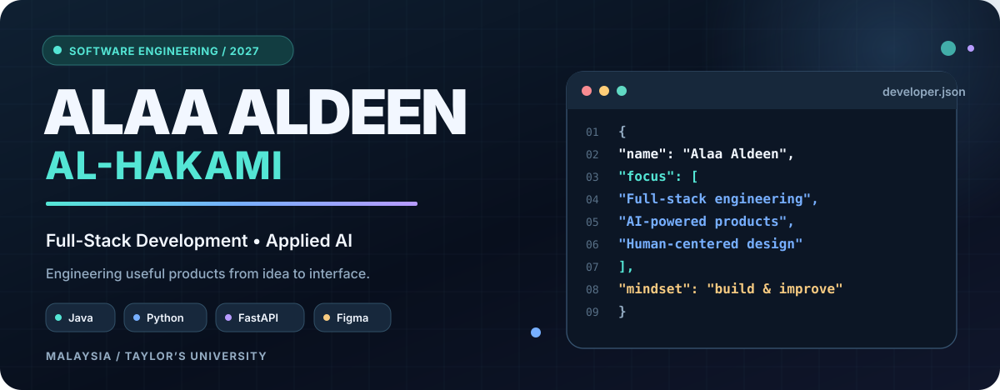
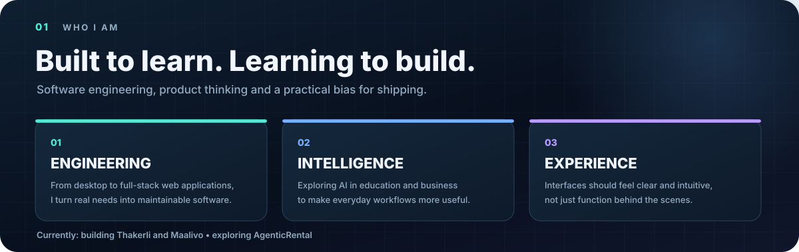
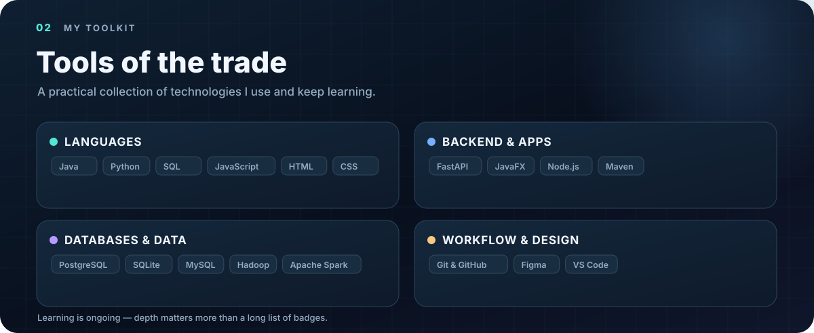
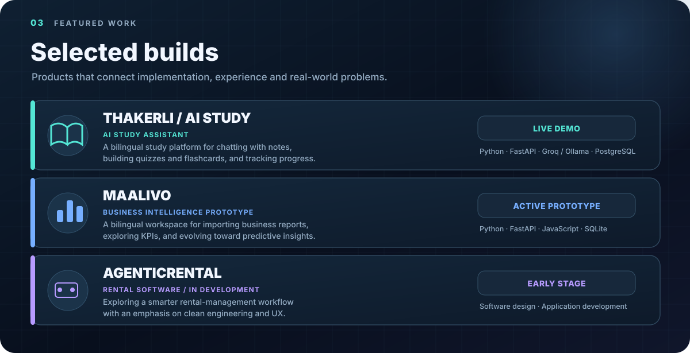
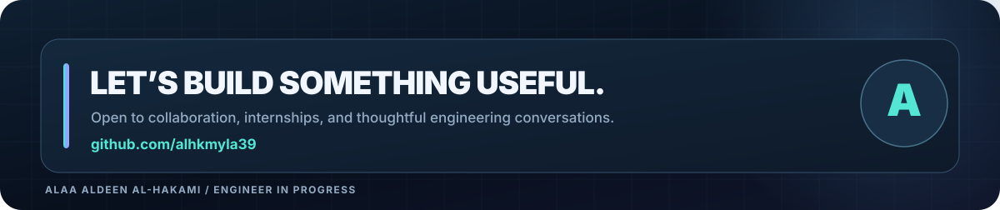

  

  
  
  

  <b>Hey, I’m Alaa.</b> I build practical software across full-stack development, AI-powered experiences, and data-driven products.
   
  Software Engineering student at Taylor’s University, Malaysia · Interested in software engineering internships.

  
  
  

> **A note on projects:** Some work is in private repositories or active development. The summaries above describe the projects without publishing private source code. Maalivo is a prototype, and AgenticRental is early-stage work.

### GitHub activity

  
  

  

  
<b>What I’m focusing on right now</b>

   
  <ul>
    <li>Improving <b>Thakerli</b>, an Arabic/English AI study companion.</li>
    <li>Building the <b>Maalivo</b> business reporting and analytics prototype.</li>
    <li>Exploring the architecture and product direction for <b>AgenticRental</b>.</li>
    <li>Strengthening practical full-stack engineering and software design skills.</li>
  </ul>

  
  

Designed with intention. Built to keep improving.
